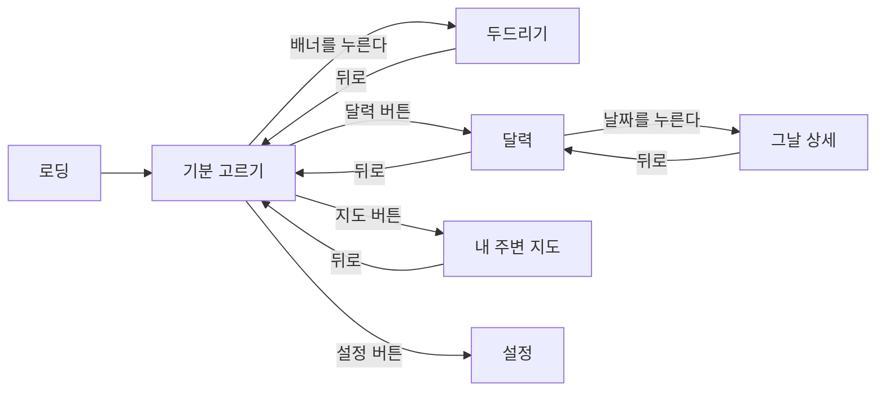

# 기능 명세

가치와 문구 원칙은 `docs/PRINCIPLES.md`, 그 근거는 `docs/EVIDENCE.md` 에 있다. 이 명세와 어긋나면 원칙이 이긴다.

작성 2026-11-18. 화면은 최소 디자인으로 만든다. 모양은 디자이너가 정하고, 이 문서는 동작만 정한다.

1단계 파일럿은 1~5번 화면, 테마, 진동과 소리까지다. 6번 지도는 여기서 동작을 정해 두고 3단계에 만든다.

## 앱이 해 주는 세 가지

| 하는 일 | 뜻 | 맡는 화면 |
|---|---|---|
| 보여 준다 | 지금 내 기분이 무엇이고 얼마나 큰지 보인다. 내 주변 사람들의 오늘 기분도 보인다 | 두드리기의 채움, 내 주변 지도 |
| 다스려 준다 | 두드리기로 들어와 몸과 숨을 가라앉힌다. 화를 털어 내는 분출로 쓰지 않는다(docs/EVIDENCE.md). 캐릭터가 함께한다 | 두드리기, 캐릭터(콘셉트 후보) |
| 돌아보게 한다 | 지난 날들의 기분을 모아 보고 흐름을 본다 | 달력, 그날 상세, 돌아보기 |

새 기능은 이 셋 중 어디에 들어가는지부터 정한다. 어디에도 안 들어가면 넣지 않는다.




## 1. 로딩

```
┌──────────────────┐
│                  │
│                  │
│     (앱 이름)     │
│                  │
│                  │
└──────────────────┘
```

- 저장된 기록을 불러오는 동안 보인다. 불러오기가 끝나면 바로 기분 고르기로 넘어간다.
- 최소 표시 시간은 두지 않는다. 일부러 기다리게 하지 않는다.
- 불러오기에 실패하면 기록이 깨졌다고 알리고, 새로 시작할지 묻는다. 말없이 지우지 않는다.

## 2. 기분 고르기

```
┌──────────────────┐
│ 오늘 [지도][달력][⚙]│
├──────────────────┤
│   😊 행복해요     │
├──────────────────┤
│   😡 화나요       │
├──────────────────┤
│   😢 슬퍼요       │
├──────────────────┤
│   😰 불안해요     │
└──────────────────┘
```

- 기분마다 큼직한 배너 하나. 화면 높이를 기분 개수로 나눠 채운다.
- 배너에는 오늘 그 기분을 두드린 누적 수를 작게 보여 준다.
- 배너를 누르면 바로 두드리기 화면으로 간다. 확인 단계는 없다.
- 기분은 행복 쪽과 슬픔 쪽 중 하나에 속한다. 목록은 아래 "정할 것" 참고.

## 3. 두드리기

```
┌──────────────────┐
│ ←    행복해요     │
│                  │
│                  │  ← 화면 전체가 터치 영역
│░░░░░░░░░░░░░░░░░░│
│▓▓▓▓▓▓▓▓▓▓▓▓▓▓▓▓▓▓│  ← 두드릴수록 아래에서 차오른다
│▓▓▓▓▓▓▓▓▓▓▓▓▓▓▓▓▓▓│
│      오늘 128     │  ← 오늘 누적 수
└──────────────────┘
```

화면에는 두 가지 값이 있다. 둘을 섞지 않는다.

| 값 | 뜻 | 저장 |
|---|---|---|
| 채움 | 지금 얼마나 세게 두드리는지. 0에서 1 사이 | 저장하지 않는다. 화면을 나가면 0 |
| 누적 수 | 오늘 이 기분을 두드린 횟수 | 저장한다. 달력의 근거 |

채움의 규칙:

- 한 번 두드리면 일정량 오른다. 1을 넘지 않는다.
- 마지막 두드림 뒤 잠깐(유예 시간)은 그대로 있다가, 그 뒤로 서서히 떨어진다. 0 밑으로 가지 않는다.
- 숫자 초안: 한 번에 1/60 오름, 유예 1초, 초당 0.07 떨어짐. 마지막으로 두드린 뒤 1초가 지나면 초당 0.07씩 줄어든다.
  처음부터 끝까지 채우려면 60번 두드려야 하고, 가득 찬 물이 다 빠지는 데 약 15초가 걸린다.
  두드림 간격이 약 1.24초(유예 1초에 한 번 오른 만큼 줄어드는 0.24초를 더한 값)보다 길면 채움이 줄고, 짧으면 오른다.
  화면에 보이는 높이는 420ms 로 부드럽게 따라가고, 빠질 때도 수면이 찰랑인다.
  실기기에서 손맛을 보고 조정한다. 값은 상수 한 곳에 둔다.
- 화면에 보이는 채움은 목표 값으로 바로 뛰지 않고, 220ms 에 걸쳐 따라가듯 부드럽게 움직인다(지수 평활). 이것은 화면의 몫이고 도메인의 채움 값은 그대로 계산한다.

```
채움
 1 ┤        ╭──╮
   │      ╭─╯  ╰╮
   │    ╭─╯     ╰─╮          두드림이 멈추면
   │  ╭─╯         ╰──╮       유예 뒤 서서히 떨어진다
 0 ┼──╯               ╰────
   └──────────────────────── 시간
     두드리는 중   멈춤
```

두드릴 때의 반응:

- 두드릴 때마다 진동과 소리를 낸다. 종류는 아래 "진동과 소리" 를 따른다.
- 누적 수가 오른다.
- 채움이 끝까지 차면 따로 정한 진동과 소리를 한 번 낸다. 그 이상의 연출은 디자인 단계에서 정한다.
- 손가락 여러 개로 동시에 두드리면 각각 한 번으로 센다. (정할 것)

저장:

- 두드릴 때마다 디스크에 쓰지 않는다. 화면을 나갈 때, 앱이 백그라운드로 갈 때, 그리고 두드리는 동안 2초마다 쓴다.
- 앱이 갑자기 꺼져도 잃는 건 최대 2초 분량이다. 쓰는 동안 새로 두드린 것은 다음 저장에 들어가고, 쓰기가 실패하면 곧 다시 쓴다.
- 파일에 이미 같은 내용이 있으면 쓰지 않는다. 두드림이 없던 2초에는 디스크를 건드리지 않는다.
- 저장 파일을 읽을 수 없으면 지우지 않고 알린다. 원본은 `.unreadable` 로 복사해 두어, 비어 있는 기록으로 이어 가서 저장해도 남는다.

## 4. 달력

```
┌──────────────────┐
│ ←   2026년 11월 → │
│ 일 월 화 수 목 금 토│
│                 😊│
│ 😢 😊 ·  😡 😊 😊 😰│
│ 😊 😊 😢 ·  ·  ·  │
└──────────────────┘
```

- 한 달씩 넘겨 본다.
- 각 날짜 칸에는 그날의 대표 기분을 보여 준다. 대표 기분은 그날 누적 수가 가장 많은 기분이다.
  동률이면 나중에 두드린 기분으로 한다. "나중"은 시각이 아니라 그날 안의 두드림 순서(일련번호)로 정한다. 기기 시계를 되돌려도 순서는 바뀌지 않는다.
- 기록이 없는 날은 비워 둔다.
- 칸의 진하기로 그날 전체 두드림 양을 보여 줄 수 있다. 디자인 단계에서 정한다.

## 5. 그날 상세

- 날짜를 누르면 그날 기분별 누적 수를 보여 준다.
- 행복 쪽 합계와 슬픔 쪽 합계를 나란히 보여 준다.

## 5-1. 돌아보기

- 달력 위쪽에서 이번 주, 이번 달을 고른다.
- 그 기간의 행복 쪽과 슬픔 쪽 비율, 가장 많았던 기분, 가장 많이 두드린 날을 보여 준다.
- 지난 기간과 견줘 행복 쪽이 늘었는지 줄었는지 한 줄로 알려 준다. 판단하거나 조언하지 않는다.
- 그날 한마디는 끝까지 채운 날 두드리기 화면을 나갈 때 묻는다(위 저장 규칙 참조).

## 6. 내 주변 지도 (3단계)

```
┌──────────────────┐
│ ←  내 주변 오늘    │
│  ╱    │     ╲    │
│ ─── 😊 ──┼───  ─ │  ← 선 위주의 단순한 지도
│   ╲  😢 │ 😊  ╱  │  ← 동네 격자마다 그 동네의 대표 기분
│ ───────┼──── 😡 ─│
│   [행복 62% 슬픔 38%] │
└──────────────────┘
```

- 지도는 길과 경계선만 남긴 선 위주 스타일로 그린다. 건물, 지형 음영, 상점 아이콘은 뺀다. 지명은 큰 동네 이름만 남긴다.
- 테마(다크, 라이트, 핑크)에 맞춰 선과 바탕 색이 바뀐다. 그래서 그림 타일이 아니라 벡터 타일을 쓴다.
- 처음엔 내 위치 중심, 반경 몇 km 를 보여 준다. 끌어서 다른 동네도 볼 수 있다.
- 동네 전체 기분 비율은 보여 줍니다(사장님 결정 2026-11-19, 표시 방식은 상수로 바꿀 수 있음). 사람과 동네 순위와 '남들보다' 문구는 금지하고, 기분 보내기는 직접 켠 사람만, 5명 미만 칸은 숨깁니다.
- 동네 격자마다 오늘 그 격자의 대표 기분을 하나 찍고, 격자를 누르면 기분별 비율을 보여 준다.
- 화면 아래에 보이는 범위 전체의 행복 쪽, 슬픔 쪽 비율을 보여 준다.

개인정보:

- 정확한 좌표는 기기 밖으로 보내지 않는다. 기기에서 동네 크기 격자(약 1~2km)로 바꾼 뒤 격자 번호만 보낸다.
- 지도에는 격자별 합계만 그린다. 사람 한 명 한 명의 점은 없다.
- 한 격자에 그날 참여한 사람이 5명 미만이면 그 칸은 비워 둔다(숨김).
- 기분은 지도 화면에 들어가 "내 기분도 보태기" 를 직접 켠 사람만 보낸다. 기본은 꺼짐이다.
- 위치 권한은 "앱 사용 중에만" 만 요청한다. 거절해도 지도 말고 나머지는 다 쓸 수 있다.

지도 후보(0단계에서 약관과 비용을 확인한 뒤 고른다):

| 후보 | 장점 | 확인할 것 |
|---|---|---|
| OpenFreeMap | 키 없이 쓰는 무료 벡터 타일. 스타일을 직접 짜서 선만 남길 수 있다 | 앱 트래픽 규모의 사용 조건, 안정성 |
| Protomaps (PMTiles) | 타일 파일 하나를 직접 올려 쓴다. 외부 서비스에 매이지 않는다 | 올려 둘 저장소 비용, 갱신 주기 |
| Stadia 의 Stamen Toner Lines | 처음부터 선만 있는 스타일 | 상업 이용은 유료, 그림 타일이라 테마별 색 바꾸기가 어렵다 |

OSM 재단의 기본 타일 서버는 앱에서 쓰지 않는다. 사용 정책상 앱 트래픽용이 아니다.
Flutter 쪽은 벡터 스타일을 그대로 쓰는 `maplibre_gl` 을 우선 본다.

## 7. 설정

- 테마: 라이트(기본), 시스템 따라가기, 다크, 핑크
- 진동: 켜기, 끄기, 세기
- 소리: 켜기, 끄기, 소리 묶음 고르기
- 지도에 내 기분 보태기: 켜기, 끄기 (3단계)

## 테마

표현 규칙(사용자 지시): 그라데이션, 번짐 그림자, 글로우는 쓰지 않는다. 면과 선은 평평한 단색만 쓴다. 깊이는 색 차이와 간격으로 나타낸다.

- 라이트, 다크, 핑크 세 벌. 기본은 라이트이고, 시스템 설정을 따라가려면 직접 고른다. 핑크도 직접 골라야 한다. 네이티브 시작 화면은 OS 다크 여부와 상관없이 흰색이다.
- 핑크는 라이트 바탕의 핑크 계열 한 벌로 시작한다. 핑크 다크는 넣지 않는다. (정할 것)
- 색은 이름 붙은 토큰(바탕, 글자, 강조, 채움, 행복 쪽, 슬픔 쪽, 지도 선, 지도 바탕)으로만 쓴다.
  세 테마는 이 토큰 값만 다르다. 디자이너는 토큰 표 하나만 바꾸면 된다.

## 진동과 소리

반응은 "진동 패턴 + 소리" 한 쌍으로 묶어 이름을 붙인다. 화면 코드는 이름만 부른다.

| 반응 | 언제 | 초안 |
|---|---|---|
| tap | 두드릴 때마다 | 기분마다 다르다. 아래 표 |
| full | 채움이 끝까지 찼을 때 | 길고 센 진동, 짧은 효과음 |
| select | 기분 배너를 눌렀을 때 | 가벼운 선택 진동, 작은 소리 |
| drop | 채움이 0으로 떨어졌을 때 | 아주 약한 진동, 소리 없음 |

기분별 tap 초안:

| 기분 | 진동 | 소리 |
|---|---|---|
| 행복해요 | 가볍고 튀는 톡 | 높고 맑은 톡 |
| 설레요 | 짧게 두 번 톡톡 | 방울 소리 |
| 화나요 | 무겁고 짧은 쿵 | 낮은 북소리 |
| 슬퍼요 | 부드럽고 긴 웅 | 낮은 물방울 |
| 불안해요 | 잘게 떨리는 진동 | 짧은 째깍 |

- 소리 묶음은 여러 벌을 두고 설정에서 고른다. 파일럿은 기본 한 벌과 부드러운 한 벌로 시작한다.
- 같은 소리를 연달아 내면 기계음처럼 들린다. 두드릴 때마다 음 높이를 조금씩 흔든다.
- 빠른 연타에도 소리가 밀리지 않게, 짧은 소리를 겹쳐 낼 수 있는 저지연 재생 엔진을 쓴다. 후보는 `flutter_soloud`.
- 아이폰 무음 스위치를 켜면 소리를 내지 않는다. 진동은 그대로 낸다.
- 진동은 초당 횟수가 많으면 간격을 둔다(최소 40ms). 소리는 겹쳐도 된다.
- 진동 세기 조절은 지원하는 기기에서만 된다. 안 되는 기기에서는 켜기와 끄기만 된다.
- 맥에는 진동이 없다. 소리만 낸다.
- 소리 파일은 직접 만들거나 상업 이용이 가능한 무료 효과음을 쓴다. 출처와 라이선스를 `THIRD_PARTY_NOTICES` 에 남긴다.

## 콘셉트 후보: 캐릭터와 힐링

요즘 유행하는 산사, 명상 앱처럼 캐릭터가 어딘가에 가서 합장하며 마음을 다스리는 분위기를 더하는 안이다.
아직 정하지 않았다. 정하면 아래처럼 기존 동작에 얹는다. 동작 규칙은 바뀌지 않고 보여 주는 방식만 바뀐다.

- 두드리기 화면에 캐릭터가 하나 있다. 채움에 따라 캐릭터의 상태가 바뀐다.
  - 행복 쪽 기분: 두드릴수록 캐릭터가 신나게 반응한다.
  - 슬픔·불안·화남 쪽 기분: 두드릴수록 캐릭터가 합장하고 호흡을 가라앉히는 동작으로 이어진다(분출이 아니라 진정 방향, `docs/PRINCIPLES.md` 기준).
- 채움이 끝까지 차면 캐릭터의 마무리 동작(합장, 절, 미소)이 한 번 나온다. 이것이 `full` 반응이다.
- 캐릭터가 머무는 장소(산사, 숲, 바다)를 배경으로 둔다. 장소를 기분별로 정할지, 사용자가 고를지는 정할 것.
- 지도에서도 격자마다 이모지 대신 캐릭터의 작은 모습으로 그 동네의 기분을 보여 줄 수 있다.
- 캐릭터와 배경은 디자이너가 새로 만든다. 다른 앱의 캐릭터, 그림, 소리를 가져오지 않는다.
- 파일럿에서는 캐릭터 자리에 상태 이름만 적힌 네모를 둔다. 상태는 `가만히`, `반응`, `합장`, `마무리` 네 가지로 시작한다.
  디자이너가 Rive 나 Lottie 로 만든 애니메이션을 넣으면 상태 이름으로 바로 이어지게 한다.


- 하루는 기기 시간대의 자정에서 자정까지다.
- 두드리는 중에 자정이 지나면, 그 뒤의 두드림은 다음 날로 센다.
- 시간대를 바꿔 여행해도 이미 남긴 날짜는 옮기지 않는다.

## 데이터

```
Mood        { id, 이름, 쪽: 행복 | 슬픔 }
DayRecord   { 날짜(YYYY-MM-DD), 기분별 누적 수, 기분별 마지막 두드림 시각, 기분별 마지막 두드림 일련번호,
              오늘의 한마디(note, 선택), 고른 준비 문장 id(notePresetId, 선택) }
```

대표 기분, 행복 합계, 슬픔 합계는 DayRecord 에서 계산한다. 따로 저장하지 않는다.
기기 안에만 저장한다. 서버로 보내지 않는다.

오늘의 한마디:

- 끝까지 채운 날 두드리기 화면을 나갈 때 한마디 창을 띄운다. 건너뛸 수 있고, 이미 한마디나 준비 문장이 있으면 다시 묻지 않는다.
- `note` 는 한 줄 글자이고 최대 40자(사람이 보는 글자 수)다. 줄바꿈과 제어 문자는 받지 않는다. 기기에만 남고 밖으로 보내지 않는다.
- `notePresetId` 는 고른 준비 문장의 id(소문자, 숫자, 밑줄, 32자 이하)다. 나중에 지도로 보낼 수 있는 것은 이것뿐이다. 준비 문장을 고친 글은 id 를 붙이지 않는다.
- 두드림이 없는 날에는 한마디를 붙일 수 없다.

저장 파일의 규칙:

- 파일 버전은 2다. 날짜마다 `moods`(기분별 값)와 선택 항목 `note`, `presetId` 를 둔다. 버전 1 파일(날짜가 곧 기분별 값)도 그대로 읽는다.
- 한마디가 40자를 넘거나 준비 문장 id 형식이 틀리면 읽기 실패로 본다.

- 날짜 키는 달력에 있는 날짜여야 한다(2026-02-31 은 읽기 실패). 시간대의 자정 유무와 무관하게 달력으로만 검사한다.
- 저장 기한은 벽시계가 아니라 앱이 켜진 뒤 흐른 시간(단조 시계)으로 잰다. 기기 시계를 바꿔도 저장 시점이 밀리지 않는다.
- 읽을 수 없는 파일은 `.unreadable`, `.unreadable.2` 처럼 번호를 붙여 모두 남긴다. 같은 내용은 다시 복사하지 않는다.
- 알려진 한계: 같은 날짜 키가 파일에 두 번 있으면 JSON 해석기(jsonDecode)가 뒤의 것만 남긴다. 이것은 막지 않는다.

## 이번에 하지 않는 것 (계획 범위)

- 지도와 다른 사람의 기분 만들기 (계획: 동작은 6번에 정해 두고 3단계에 만든다)
- 로그인, 백업, 기기 간 동기화
- (현재 기능 참고: 선택형 저녁 알림과 홈 화면 위젯·바로가기는 파일럿에 구현되었고 실기기 확인이 남아 있다. `docs/NATIVE_SURFACES.md`)

## 정할 것

1. 기분 목록과 각각의 쪽. 초안: 행복해요(행복), 설레요(행복), 화나요(슬픔), 슬퍼요(슬픔), 불안해요(슬픔).
   "슬픔 쪽" 이라는 이름 대신 "나쁜 쪽" 이 맞는지도 정한다.
2. 채움이 끝까지 찼을 때 무엇을 할지. 그냥 머무를지, 보상 연출을 줄지.
3. 손가락 여러 개 동시 터치를 셀지.
4. 하루에 셀 수 있는 수에 상한을 둘지(남과 비교하거나 순위를 매기는 용도로는 쓰지 않는다).
5. 달력의 대표 기분 규칙이 위 초안(가장 많이 두드린 기분)으로 맞는지.
6. 핑크 테마를 라이트 한 벌로 할지, 핑크 다크도 둘지.
7. 기분별 진동과 소리 초안이 맞는지. 소리 묶음은 몇 벌로 시작할지.
8. 지도 격자 크기와 "최소 몇 명부터 보여 줄지".
9. 캐릭터와 힐링 콘셉트로 갈지. 간다면 장소를 기분별로 정할지, 사용자가 고를지.
10. (정해짐) 그날 한마디를 넣는다. 끝까지 채운 날에만 묻는다.
